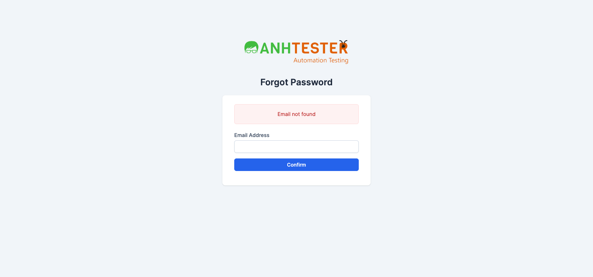
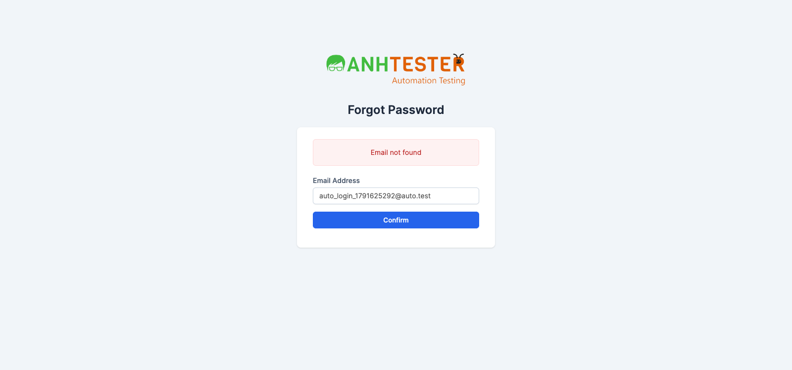
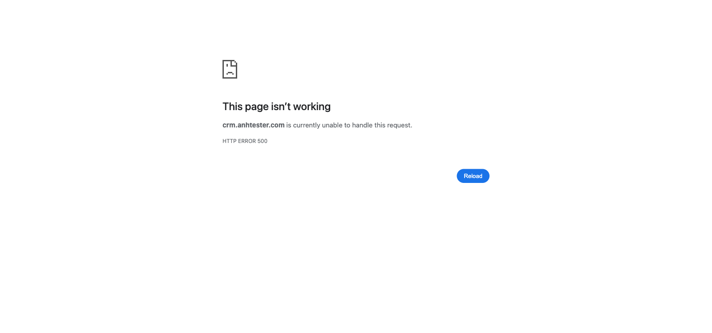
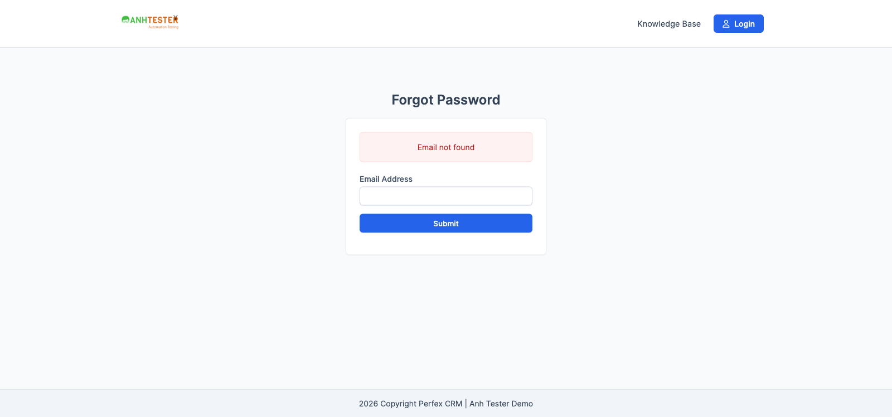
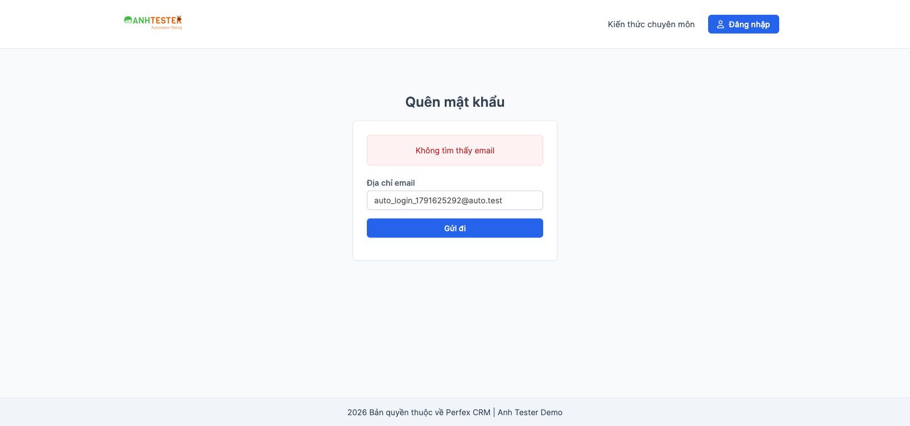
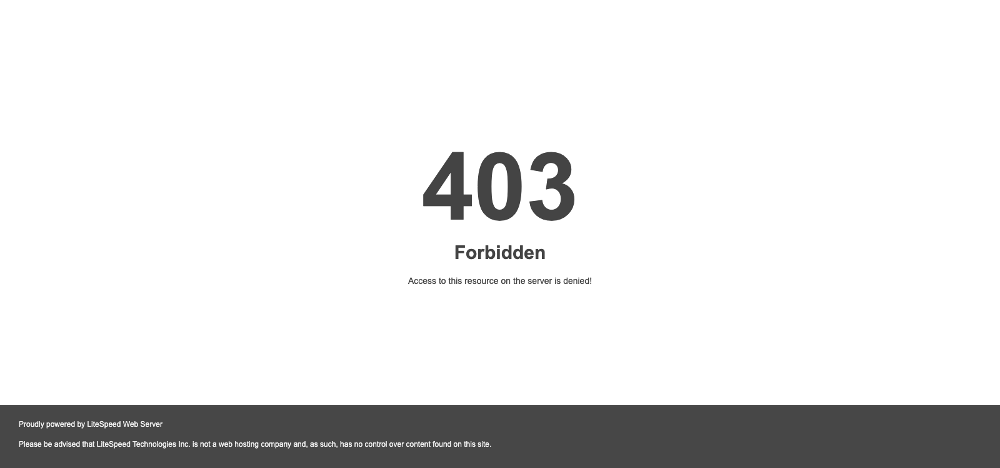
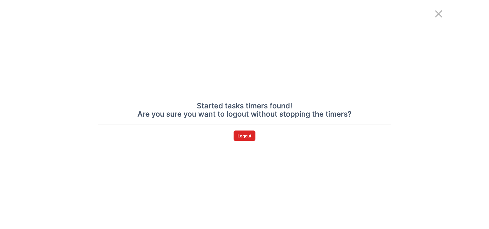
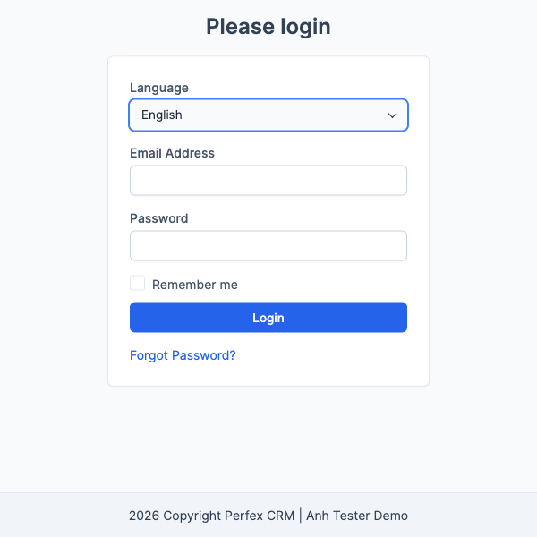

# Execution Report — Đăng nhập (`LOGIN`) · Part 02 · 03 · 04 (TC còn lại)

| Thông tin | Nội dung |
|---|---|
| Run ID | run_1791625292 |
| Nền tảng | `web` |
| Loại nguồn | `Bộ TC` |
| Nguồn TC | [part_02_web_quan_tri.md](../../../../testcases/login/web/parts/part_02_web_quan_tri.md) · [part_03_web_quen_mat_khau_cong.md](../../../../testcases/login/web/parts/part_03_web_quen_mat_khau_cong.md) · [part_04_web_ky_thuat_phi_chuc_nang.md](../../../../testcases/login/web/parts/part_04_web_ky_thuat_phi_chuc_nang.md) |
| Phạm vi | 76 TC — toàn bộ TC chưa chạy của module (part 01 đã chạy ở `run_1791623905`) · loại 0 TC `@Deprecated` |
| Môi trường | `BASE_URL` trong `.env` (`https://crm.anhtester.com`) — môi trường demo dùng chung |
| Build / Version | `app.version = 316` (theo `docs/requirements/README.md`) |
| Tài khoản | `EMAIL_ADMIN` (Staff) · `EMAIL_CUSTOMER` (contact cổng) trong `.env` — người chạy tự nhập mật khẩu |
| Trình duyệt | Chromium qua Playwright MCP · headed · viewport `1600×750` |
| Người thực hiện | tphatspeed (agent hỗ trợ) |
| Bắt đầu → Kết thúc | 10-10-2026 16:41 → 17:21 (≈ 40 phút, gồm thời gian chờ người chạy nhập mật khẩu 13 lần) |
| Môi trường dùng chung? | Có — auto-skip TC phá huỷ đang BẬT. User chốt trong phiên: TC_073 **chạy** (chấp nhận rủi ro khoá tài khoản dùng chung) · TC_031 / TC_085 **được** tạo rồi xoá task test |
| Test data | Hậu tố timestamp của lần chạy: `1791625292` (thay phần số mẫu trong TC) |

> "Cửa sổ ẩn danh mới" được dựng bằng cách xoá toàn bộ cookie của browser context trước TC. 🔧 "View Source" được kiểm trên **HTML gốc** máy chủ trả về cho request của trang (không phải DOM sau khi script chạy).

## 1. Tổng kết

| Trạng thái | Số lượng | Tỷ lệ |
|---|---|---|
| ✅ PASS | 57 | 75,0% |
| ❌ FAIL | 13 | 17,1% |
| ⚠️ BLOCKED | 5 | 6,6% |
| ⏭️ SKIPPED | 1 | 1,3% |
| **Tổng** | **76** | 100% |

> **Pass rate (không tính SKIPPED):** 57/75 = **76,0%** · Tổng TC trong phạm vi: 76 · TC thực chạy: 70 (5 BLOCKED + 1 SKIPPED không chạy được)

**Phân loại 13 FAIL:**

| Nhóm | TC | Ý nghĩa |
|---|---|---|
| `@KnownBug` — FAIL có chủ đích, lỗi đã biết | 040 · 042 · 045 · 046 · 056 · 058 · 071 · 076 (8) | Hệ thống vẫn sai đúng như Expected đã cảnh báo — chưa được sửa |
| **Lỗi mới** phát hiện ở lần chạy này | **070** (mã phiên không đổi khi đăng nhập — session fixation) · 029 (🔧 hạn phiên không gia hạn theo từng thao tác) (2) | 070 đề xuất báo bug bảo mật; 029 cần đối chiếu REQ-LOGIN-66 với Dev |
| Expected chưa có evidence — đối chiếu lại TC trước khi báo bug | 067-b (`ASM-03`) · 085-c (`@NeedsVerify`) · 088 (`@NeedsVerify`, `ASM-05`) (3) | Hệ thống hành xử khác giả định của TC |

> **Cách chạy đáng lưu ý:** "cửa sổ ẩn danh mới" = xoá cookie browser context. Một số TC có bước đăng nhập giống hệt nhau được **dùng chung một lần đăng nhập** (ghi rõ ở cột Ghi chú: 069/070/036/029/025 · 017/032 · 018/033 · 024/037 · 035/077 · 026/071/027/028/034 · 020/085). Mật khẩu luôn do người chạy nhập; Email được agent điền lại từ ô người chạy đã gõ (giữ tạm trong `localStorage` của trình duyệt test, đã xoá khi teardown, không ghi vào báo cáo).

## 2. Kết quả từng TC

| TC ID | Test Scenario | Kết quả | Bước fail | Ghi chú |
|---|---|---|---|---|
| CRM_LOGIN_TC_012 | Bỏ trống Email thì báo bắt buộc nhập Email | ✅ PASS | — | `a`, `b` (3 dấu cách) đều: `POST` rồi nạp lại trang Login, đúng 1 khung đỏ nhạt `The Email Address field is required.` phía trên ô Email, ô Password trống · 🔧 thẻ ô Password không có `value` |
| CRM_LOGIN_TC_013 | Bỏ trống Password thì báo bắt buộc nhập Password | ✅ PASS | — | `a`, `b` đều: đúng 1 khung `The Password field is required.`, ô Email không hiện lại chuỗi đã nhập · 🔧 thẻ ô Email không có `value` |
| CRM_LOGIN_TC_014 | Bỏ trống cả Email và Password thì hiện đủ hai thông báo | ✅ PASS | — | Đúng 2 khung đỏ nhạt (`The Password field is required.` · `The Email Address field is required.`), vẫn ở Login |
| CRM_LOGIN_TC_015 | Email sai cấu trúc bị trình duyệt chặn ngay, không gửi | ✅ PASS | — | `a`→`e` đều bị trình duyệt chặn (`validationMessage` của Chromium, VD `Please include an '@'…`), không khung đỏ, chữ 2 ô còn nguyên · 🔧 không phát sinh request `POST /admin/authentication` · bong bóng của trình duyệt không chụp được ảnh, xác nhận qua trạng thái validity |
| CRM_LOGIN_TC_016 | Email có `@` nhưng tên miền không hợp lệ thì máy chủ từ chối | ✅ PASS | — | `a` (`@autotest`), `b` (`auto..login`) đều nạp lại, 1 khung `The Email Address field must contain a valid email address.`, ô Email trống · 🔧 thẻ ô Email không có `value` |
| CRM_LOGIN_TC_017 | Email viết HOA toàn bộ vẫn đăng nhập được | ✅ PASS | — | Agent điền `EMAIL_ADMIN` viết HOA (lấy từ ô người chạy đã gõ ở lần đầu, không ghi giá trị), người chạy tự nhập mật khẩu → Dashboard `https://crm.anhtester.com/admin/` |
| CRM_LOGIN_TC_018 | Email có khoảng trắng đầu và cuối vẫn đăng nhập được | ✅ PASS | — | Gõ bằng bàn phím 2 dấu cách + `EMAIL_ADMIN` + 2 dấu cách (ô kiểu `email` — trình duyệt tự cắt khoảng trắng hai đầu) · người chạy nhập mật khẩu → Dashboard, không báo lỗi |
| CRM_LOGIN_TC_019 | Email đúng định dạng nhưng không tồn tại thì báo lỗi chung | ✅ PASS | — | `a`, `b` (phần trước `@` dài 64 ký tự) đều ở lại `/admin/authentication`, 1 khung `Invalid email or password` (không dấu chấm cuối), 2 ô trống · 🔧 cả 2 thẻ không có `value` |
| CRM_LOGIN_TC_020 | Email tồn tại nhưng sai mật khẩu hiện đúng cùng thông báo như email không tồn tại | ✅ PASS | — | Bước 4 (email không tồn tại) và bước 7 (`EMAIL_ADMIN` + mật khẩu sai `auto_wrong_1791625292`, gửi sai đúng 1 lần) giống hệt nhau: cùng chữ `Invalid email or password`, cùng khung đỏ nhạt, cùng địa chỉ `/admin/authentication` · bước 9 người chạy nhập mật khẩu đúng → Dashboard |
| CRM_LOGIN_TC_021 | Thông báo sai thông tin chỉ hiện một lần, F5 thì biến mất | ✅ PASS | — | F5 → `GET`, khung đỏ biến mất, không có hộp hỏi gửi lại biểu mẫu · mở lại trang không có khung nào · 🔧 `POST 303` → `GET 200` (PRG) |
| CRM_LOGIN_TC_022 | Ô Password nhận mọi kiểu dữ liệu, che ký tự, báo sai thông tin chung | ✅ PASS | — | `a`–`d` (1 · 255 ký tự · ký tự đặc biệt · tiếng Việt + emoji) nhận đủ độ dài, ô kiểu `password` · `e` dán bằng Cmd+V được · cả 5 đều 1 khung `Invalid email or password`, không trang lỗi |
| CRM_LOGIN_TC_023 | Ô Remember me tích / bỏ tích được bằng chuột | ✅ PASS | — | Chưa tích → tích → bỏ tích → bấm **chữ** `Remember me` thì tích (`label for=remember`) — xác nhận `ASM-04` |
| CRM_LOGIN_TC_024 | Mở deep link khi chưa đăng nhập, đăng nhập xong luôn vào Dashboard | ✅ PASS | — | `/admin/clients` → bị đưa về `/admin/authentication` · đăng nhập (người chạy nhập mật khẩu) → `https://crm.anhtester.com/admin/` (Dashboard), không phải Customers |
| CRM_LOGIN_TC_025 | Không tích Remember me thì khi phiên mất không tự đăng nhập lại | ✅ PASS | — | Dùng chung lần đăng nhập · 🔧 ngay sau đăng nhập chỉ có `csrf_cookie_name` + `sp_session`, không `autologin` · xoá `sp_session` → mở `/admin/` bị đưa về `/admin/authentication` |
| CRM_LOGIN_TC_026 | Tích Remember me thì tạo dấu ghi nhớ đăng nhập hạn 62 ngày | ✅ PASS | — | Ô `Remember me` có dấu tích · đăng nhập → Dashboard · 🔧 cookie `autologin`: hạn = lúc đăng nhập + 62,000 ngày · `Secure` bật · `SameSite=Lax` · `Path=/` · giá trị sau URL-decode khớp hình thái `a:2:{s:7:"user_id";s:<n>:"<id>";s:3:"key";s:16:"<16 ký tự hex>";}` |
| CRM_LOGIN_TC_027 | Có dấu ghi nhớ thì khi phiên mất vẫn vào thẳng Dashboard | ✅ PASS | — | Dùng chung lần đăng nhập · xoá mọi cookie trừ `autologin` (còn đúng 1 cookie) · mở `/admin/` → `200 /admin/` Dashboard, không qua trang Login · có `sp_session` mới |
| CRM_LOGIN_TC_028 | Mỗi lần dùng dấu ghi nhớ để vào lại, hạn được gia hạn thêm 62 ngày | ✅ PASS | — | Dùng chung lần đăng nhập · T1 lúc đăng nhập · chờ 151 giây · bước 5–6 như TC_027 → Dashboard · 🔧 T2 = lúc bước 6 + 62,000 ngày, muộn hơn T1 151 giây · giá trị `autologin` giữ nguyên |
| CRM_LOGIN_TC_029 | Hạn phiên đăng nhập được gia hạn 8 giờ sau mỗi lần thao tác | ❌ FAIL | 4 (🔧) | Dùng chung lần đăng nhập · chờ 142 giây rồi bấm `Customers` → mở bình thường ✅ · T2 muộn hơn T1 **47 giây** ✅ nhưng 🔧 T2 ≈ lúc bấm + **7 giờ 58 phút** — lần gia hạn xảy ra ở giây thứ ~47 sau đăng nhập, **không** phải lúc bấm Customers · xem FAIL #1 |
| CRM_LOGIN_TC_030 | Không thao tác quá 8 giờ thì phiên hết hạn | ⏭️ SKIPPED | — | Tag `@PersonalOnly` — chờ 8 giờ 5 phút, QA tự chạy và theo dõi ngoài workflow |
| CRM_LOGIN_TC_031 | Đang có bộ đếm giờ chạy thì bấm Logout sẽ hỏi xác nhận trước khi đăng xuất | ✅ PASS | — | Tạo task `auto_login_timer_1791625292_031` (ID 2137), `Start Timer` → bộ đếm chạy · Logout → **chưa** đăng xuất, popup đúng nguyên văn `Started tasks timers found!` `Are you sure you want to logout without stopping the timers?` + nút `Logout` · bấm `Logout` trong popup → `/admin/authentication` · người chạy đăng nhập lại · dừng bộ đếm · xoá task → `get_task_data/2137` trả `404` · xác nhận `ASM-18` phần câu chữ, đề nghị gỡ `@NeedsVerify` |
| CRM_LOGIN_TC_032 | Đăng xuất xong thì phiên cũ không dùng lại được | ✅ PASS | — | Dùng chung lần đăng nhập với TC_017 · không có bộ đếm giờ · Logout → `/admin/authentication` · 🔧 `sp_session` sau Logout khác giá trị đã lưu (REQ-29) · gắn lại giá trị cũ → mở `/admin/` vẫn ở Login |
| CRM_LOGIN_TC_033 | Bấm Back sau khi đăng xuất không hiển thị lại trang quản trị | ✅ PASS | — | Dùng chung lần đăng nhập với TC_018 · không bộ đếm giờ · Logout → Login · Back → vẫn `/admin/authentication`, trang Login, không có menu / dữ liệu quản trị |
| CRM_LOGIN_TC_034 | Đăng xuất làm dấu ghi nhớ cũ mất tác dụng | ✅ PASS | — | Dùng chung lần đăng nhập (đang vào bằng dấu ghi nhớ) · không bộ đếm giờ · lưu `autologin` → Logout → Login · 🔧 sau Logout trình duyệt vẫn giữ `autologin` (đã chấp nhận `AMB-LOGIN-12`) · xoá mọi cookie, gắn lại `autologin` cũ → mở `/admin/` vẫn ở Login |
| CRM_LOGIN_TC_035 | Bấm nút Login hai lần liên tiếp thật nhanh vẫn đăng nhập bình thường | ✅ PASS | — | Người chạy nhập mật khẩu, agent nhấp đúp nút `Login` → Dashboard, không trang lỗi, không bị đòi đăng nhập lại · chỉ ghi nhận 1 `POST 303` (lần bấm thứ hai bị trình duyệt gộp khi trang bắt đầu chuyển) · xác nhận `ASM-09` |
| CRM_LOGIN_TC_036 | Bấm Back ngay sau khi đăng nhập không về lại form đăng nhập | ✅ PASS | — | Dùng chung lần đăng nhập với TC_069/070 · Back → vẫn Dashboard `https://crm.anhtester.com/admin/`, không có form |
| CRM_LOGIN_TC_037 | Đăng xuất ở một tab thì tab còn lại cũng mất quyền truy cập | ✅ PASS | — | Dùng chung lần đăng nhập với TC_024 · không bộ đếm giờ · Cmd+bấm `Customers` mở tab 2 (Customers) · tab 1 Logout → Login · tab 2 bấm `Dashboard` → bị đưa về `/admin/authentication` · xác nhận `ASM-08` |
| CRM_LOGIN_TC_038 | Mất mạng lúc bấm Login thì không vào được, có mạng lại thì đăng nhập bình thường | ✅ PASS | — | Người chạy nhập mật khẩu · ngắt mạng trình duyệt (tương đương DevTools → `Offline`) · bấm `Login` → trang `ERR_INTERNET_DISCONNECTED` của trình duyệt, không vào Dashboard · bật lại mạng, mở lại form, người chạy nhập lại → Dashboard · xác nhận `ASM-07` · đã Logout dọn phiên |
| CRM_LOGIN_TC_039 | Quên mật khẩu quản trị: Email sai cấu trúc bị trình duyệt chặn | ✅ PASS | — | `a`, `b`, `c` đều bị trình duyệt chặn, không khung đỏ, chữ còn nguyên · 🔧 không có `POST /admin/authentication/forgot_password` |
| CRM_LOGIN_TC_040 | Quên mật khẩu quản trị: bỏ trống Email thì báo bắt buộc | ❌ FAIL | 3 | `@KnownBug` (`AMB-LOGIN-26`) — hiện `Email not found` thay vì `The Email Address field is required.` · xem FAIL #2 |
| CRM_LOGIN_TC_041 | Quên mật khẩu quản trị: Email sai tên miền bị máy chủ từ chối, ô giữ giá trị | ✅ PASS | — | Khung `The Email Address field must contain a valid email address.` · ô Email vẫn hiện `auto_login_1791625292@autotest` |
| CRM_LOGIN_TC_042 | Quên mật khẩu quản trị: email không tồn tại hiện thông báo chung | ❌ FAIL | 4 | `@KnownBug` (`AMB-LOGIN-06`) — hiện `Email not found`, lộ việc email không tồn tại · xem FAIL #3 |
| CRM_LOGIN_TC_043 | Quên mật khẩu quản trị: email tồn tại nhận được email đặt lại | ⚠️ BLOCKED | — | Pre-condition ⛔: cần tài khoản Staff **riêng** có hộp thư test đọc được (`RISK-LOGIN-03`); TC cấm dùng `EMAIL_ADMIN`. Bước 8 (mở hộp thư) không quan sát được |
| CRM_LOGIN_TC_044 | Quên mật khẩu quản trị: liên kết trong email đặt lại dùng được | ⚠️ BLOCKED | — | Phụ thuộc TC_043 + hộp thư test (`RISK-LOGIN-03`); đổi mật khẩu tài khoản — không chạy trên tài khoản dùng chung |
| CRM_LOGIN_TC_045 | Mở liên kết đặt lại mật khẩu thiếu tham số thì hiện trang "không tìm thấy" | ❌ FAIL | 2 | `@KnownBug` (`AMB-LOGIN-13`) — 🔧 mã phản hồi `500`, trình duyệt hiện trang `HTTP ERROR 500` · xem FAIL #4 |
| CRM_LOGIN_TC_046 | Tiêu đề tab trang Quên mật khẩu quản trị là `Forgot Password?` | ❌ FAIL | 2 | `@KnownBug` — tiêu đề thực tế `Perfex CRM \| Anh Tester Demo - Login` (chứa chữ `Login`) · xem FAIL #5 |
| CRM_LOGIN_TC_047 | Login cổng: Email sai định dạng được gửi lên máy chủ, báo lỗi dưới ô Email | ✅ PASS | — | `a`→`e`: ô Email kiểu `text`, trình duyệt không chặn, trang nạp lại · chữ đỏ `The Email Address field must contain a valid email address.` ngay dưới ô Email · ô không giữ chuỗi · 🔧 có `POST /authentication/login`, ô Email không có `value` |
| CRM_LOGIN_TC_048 | Login cổng: bỏ trống Email thì báo bắt buộc dưới ô Email | ✅ PASS | — | `a`, `b`: chữ đỏ `The Email Address field is required.` ngay dưới ô Email · xác nhận `ASM-19` cho ca `a` |
| CRM_LOGIN_TC_049 | Login cổng: bỏ trống Password thì báo bắt buộc dưới ô Password | ✅ PASS | — | `a`, `b`: chữ đỏ `The Password field is required.` ngay dưới ô Password · xác nhận `ASM-19` cho ca `a` |
| CRM_LOGIN_TC_050 | Login cổng: thông tin sai hiện thông báo nổi góc trên phải, tự ẩn ~3,5 giây | ✅ PASS | — | `a`, `b` (`auto'--@auto.test`): thông báo nền đỏ nhạt, biểu tượng chuông, `Invalid username or password`, góc trên phải (cách mép phải 7px, trên 20px) · tự ẩn sau 3,8 giây tính từ lúc bấm · ô Email trống · xác nhận `ASM-16` |
| CRM_LOGIN_TC_051 | Login cổng: chọn Vietnamese thì trang hiển thị toàn bộ tiếng Việt | ✅ PASS | — | Trang tự nạp lại ngay · Bảng kiểm 1–5 đạt nguyên văn (`Xin hãy đăng nhập` · `Ngôn ngữ` / `Vietnamese` · `Địa chỉ email` · `Mật khẩu` · `Giữ đăng nhập cho những lần sau` · `Đăng nhập` · `Quên mật khẩu?` · `Kiến thức chuyên môn` · `2026 Bản quyền thuộc về Perfex CRM \| Anh Tester Demo`) · chọn lại English về `Please login` |
| CRM_LOGIN_TC_052 | Login cổng: ngôn ngữ đã chọn được ghi nhớ khi mở lại trang | ✅ PASS | — | Mở lại trang và tab mới cùng context vẫn `Xin hãy đăng nhập` · chọn lại English về `Please login` · 🔧 cookie `contact_language`: `Secure` bật, hạn 93 ngày · bước 4 mở tab mới cùng context rồi đóng tab đó (không đóng tab chính để MCP giữ phiên điều khiển) |
| CRM_LOGIN_TC_053 | Đổi ngôn ngữ cổng không đổi ngôn ngữ trang Login quản trị | ✅ PASS | — | Cổng tiếng Việt → Login quản trị vẫn `Login` · `Email Address` · `Password` · nút `Login` · dọn về English |
| CRM_LOGIN_TC_054 | Trang đăng ký đang tắt, mở thẳng địa chỉ thì về Login cổng | ✅ PASS | — | `/authentication/register` → `/authentication/login`, trang `Please login`, không có form đăng ký |
| CRM_LOGIN_TC_055 | Quên mật khẩu cổng: Email sai cấu trúc bị trình duyệt chặn | ✅ PASS | — | `a`, `b`, `c` bị chặn, không khung đỏ, chữ còn nguyên · 🔧 không có `POST /authentication/forgot_password` |
| CRM_LOGIN_TC_056 | Quên mật khẩu cổng: bỏ trống Email thì báo bắt buộc | ❌ FAIL | 3 | `@KnownBug` (`AMB-LOGIN-26`) — hiện `Email not found` · xem FAIL #6 |
| CRM_LOGIN_TC_057 | Quên mật khẩu cổng: Email sai tên miền bị từ chối, ô giữ giá trị | ✅ PASS | — | Khung `The Email Address field must contain a valid email address.` · ô vẫn `auto_login_1791625292@autotest` |
| CRM_LOGIN_TC_058 | Quên mật khẩu cổng: email không tồn tại hiện thông báo chung đúng ngôn ngữ | ❌ FAIL | 5 · biến thể `a`, `b` | `@KnownBug` (`AMB-LOGIN-06`) — `a` hiện `Email not found`, `b` hiện `Không tìm thấy email` · xem FAIL #7 |
| CRM_LOGIN_TC_059 | Quên mật khẩu cổng: email contact tồn tại nhận được email đặt lại | ⚠️ BLOCKED | — | Đã có `EMAIL_CUSTOMER` nhưng **không** có quyền đọc hộp thư của contact (`RISK-LOGIN-03`) — bước 8 không quan sát được. Không gửi yêu cầu đặt lại để tránh phát email ra ngoài vô ích |
| CRM_LOGIN_TC_060 | Quên mật khẩu cổng: liên kết trong email đặt lại dùng được | ⚠️ BLOCKED | — | Phụ thuộc TC_059 + hộp thư test; đổi mật khẩu contact dùng chung |
| CRM_LOGIN_TC_061 | Tài khoản Staff đúng email + mật khẩu vẫn không đăng nhập được cổng khách hàng | ✅ PASS | — | Login cổng (English), `EMAIL_ADMIN` + người chạy nhập mật khẩu → thông báo nổi nền đỏ nhạt `Invalid username or password` góc trên phải, vẫn ở `Please login` (`/authentication/login`), nút `Login` đầu trang còn — không vào khu khách hàng |
| CRM_LOGIN_TC_062 | Tài khoản contact đúng email + mật khẩu vẫn không đăng nhập được khu quản trị | ✅ PASS | — | Người chạy nhập `EMAIL_CUSTOMER` / `PASSWORD_CUSTOMER` ở Login quản trị → ở lại trang Login, khung đỏ `Invalid email or password` · mở `/admin/` vẫn về Login · `@NeedsVerify` xác nhận: nguyên văn thông báo là `Invalid email or password` (đóng `ASM-12`), đề nghị gỡ tag và cập nhật `AMB-SYS-03` |
| CRM_LOGIN_TC_063 | Biểu mẫu Login quản trị gửi kèm mã chống giả mạo và được máy chủ chấp nhận | ✅ PASS | — | Bước 3, 4 đều khung `Invalid email or password` · 🔧 trường ẩn `csrf_token_name` dài 32 ký tự · payload lần 1 = `csrf_token_name`, `email`, `password`; lần 2 thêm `remember` |
| CRM_LOGIN_TC_064 | Chuỗi tiêm SQL trong ô Email không vượt qua đăng nhập | ✅ PASS | — | `a`, `b` đều ở lại Login, khung `Invalid email or password`, không trang lỗi · xác nhận `ASM-16` |
| CRM_LOGIN_TC_065 | Chuỗi tiêm SQL / script trong ô Password không vượt qua đăng nhập | ✅ PASS | — | `a`, `b`, `c`: khung `Invalid email or password`, không vào Dashboard, không bật hộp thoại nào |
| CRM_LOGIN_TC_066 | Quên mật khẩu quản trị: chuỗi lạ trong ô Email giữ nguyên văn, không chạy script | ✅ PASS | — | `a`, `b`: trang nạp lại kèm thông báo hệ thống, ô Email hiện đúng nguyên chuỗi, bấm vào ô không bật hộp thoại |
| CRM_LOGIN_TC_067 | Login cổng: mã script / chuỗi tiêm trong ô Email bị từ chối là sai định dạng | ❌ FAIL | 5 · biến thể `b` | `a`, `c` PASS · `b` (`">`) bị tường lửa máy chủ chặn `403 Forbidden` (LiteSpeed), rời form Login — không có chữ đỏ dưới ô Email · không bật `alert`, không chèn ảnh · Expected dựa trên `ASM-03` → đối chiếu lại TC · xem FAIL #8 |
| CRM_LOGIN_TC_068 | Quên mật khẩu cổng: chuỗi lạ trong ô Email giữ nguyên văn | ✅ PASS | — | `a`, `b`: ô Email đúng nguyên chuỗi, không hộp thoại |
| CRM_LOGIN_TC_069 | Cookie phiên được bảo vệ: chỉ gửi qua HTTPS, script không đọc được | ✅ PASS | — | Đăng nhập (người chạy tự nhập) → Dashboard · 🔧 `sp_session`: `HttpOnly` bật · `Secure` bật · `SameSite=Lax` · `Path=/` · dài 40 ký tự · `document.cookie` không chứa `sp_session` |
| CRM_LOGIN_TC_070 | Đăng nhập thành công thì hệ thống cấp mã phiên mới | ❌ FAIL | 4 | Trước đăng nhập đã có `sp_session` của khách ✅ · sau đăng nhập vào Dashboard ✅ · nhưng mã phiên sau đăng nhập **trùng** mã trước đăng nhập (so dấu vân tay SHA-256, không chép giá trị) — 2/2 lần · xem FAIL #9 |
| CRM_LOGIN_TC_071 | Dấu ghi nhớ đăng nhập không đọc được bằng script | ❌ FAIL | 2, 3 | `@KnownBug` (`AMB-LOGIN-05`) — dùng chung lần đăng nhập với TC_026 · 🔧 `autologin` có `HttpOnly` = **tắt**; `document.cookie` **có** chứa `autologin` · xem FAIL #10 |
| CRM_LOGIN_TC_072 | Nhập sai nhiều lần liên tiếp không làm xuất hiện CAPTCHA | ✅ PASS | — | Cookie = 0 trước khi chạy · 11 lần (`auto_login_1791625292_01…11@auto.test`) đều `Invalid email or password` · không CAPTCHA, không thông báo chờ, nút `Login` bấm được |
| CRM_LOGIN_TC_073 | Nhập sai mật khẩu 5 lần liên tiếp không làm khoá tài khoản | ✅ PASS | — | User chốt chạy ngay (chấp nhận rủi ro tài khoản dùng chung) · `EMAIL_ADMIN` + mật khẩu sai `auto_wrong_1791625292` × 5: cả 5 lần `Invalid email or password`, không thông báo khoá · lần 6 người chạy nhập mật khẩu đúng → Dashboard — tài khoản **không** bị khoá · đã Logout dọn phiên |
| CRM_LOGIN_TC_074 | Login quản trị dùng được hoàn toàn bằng bàn phím, viền focus nhìn thấy được | ✅ PASS | — | `@NeedsVerify` xác nhận thứ tự Tab: Email → Password → `Remember me` → `Login` → `Forgot Password?` → (Shift+Tab) `Login` · `Space` tích được · `Enter` gửi → `Invalid email or password` · viền xanh ô Password hiện rõ (sau hiệu ứng chuyển ~0,2 giây) · ghi chú: liên kết `Forgot Password?` khi focus **không** có viền, chỉ đậm màu chữ — bước 8 chỉ chấm focus · đề nghị gỡ `@NeedsVerify`, đóng `ASM-05` cho form này |
| CRM_LOGIN_TC_075 | Login cổng dùng được hoàn toàn bằng bàn phím | ✅ PASS | — | Con trỏ sẵn ở Email · Tab: Password (viền xanh) → `Remember me` → `Login` · `Enter` → thông báo nổi `Invalid username or password` · đề nghị gỡ `@NeedsVerify` |
| CRM_LOGIN_TC_076 | Ô Email / Password của Login quản trị khai báo gợi ý tự điền | ❌ FAIL | 2, 3 | `@KnownBug` (`AMB-LOGIN-21`) — Console có cảnh báo `[DOM] Input elements should have autocomplete attributes (suggested: "current-password")` · 🔧 `#email` và `#password` đều **không** có thuộc tính `autocomplete` · xem FAIL #11 |
| CRM_LOGIN_TC_077 | Ở màn hình điện thoại, menu mobile có mục Logout dùng được | ✅ PASS | — | Dùng chung lần đăng nhập với TC_035 · không bộ đếm giờ · viewport `375×812` (chỉ đổi kích thước, không đổi user-agent) · nút ☰ mở menu mobile · mục `Logout` hiện đủ (375×40px) · bấm → `/admin/authentication` · đề nghị gỡ `@NeedsVerify` |
| CRM_LOGIN_TC_078 | Trang Login quản trị hiển thị đủ và dùng được ở các kích thước đã chốt | ✅ PASS | — | `a` 375×812 · `b` 768×1024 · `c` 1366×768 · `d` 125% (giả lập bằng viewport 1280×600 = 1600×750 ÷ 1,25): đủ 8 thành phần, nằm trọn chiều ngang, không chữ đè / cắt (đã xem ảnh), không thanh cuộn ngang · giả lập chỉ đổi kích thước viewport, không đổi user-agent / cảm ứng · đề nghị gỡ `@NeedsVerify` |
| CRM_LOGIN_TC_079 | Đăng nhập / đăng xuất chạy đúng trên Firefox, Safari, Edge | ⚠️ BLOCKED | — | Playwright MCP của phiên này chỉ điều khiển Chromium — không có Firefox / Safari / Edge. Cần tester chạy tay trên 3 trình duyệt (`ASM-14`) |
| CRM_LOGIN_TC_081 | Trang Login cổng hiển thị đủ và dùng được ở kích thước điện thoại, máy tính bảng, 125% | ✅ PASS | — | `a`, `b`, `c` (125% giả lập 1280×600): đủ thành phần, không cuộn ngang · danh sách `Language` mở được, nằm trong màn hình (VD 375px: x 55→320), 26 dòng, có ô tìm kiếm · `Esc` đóng, vẫn `English` · đề nghị gỡ `@NeedsVerify` |
| CRM_LOGIN_TC_082 | Trang Quên mật khẩu cổng hiển thị đủ ở kích thước điện thoại, máy tính bảng | ✅ PASS | — | `a` 375×812: nút `Login` nằm trong menu thu gọn, bấm nút menu (☰) thì hiện `Knowledge Base` + `Login` · `b` 768×1024: nút `Login` hiện sẵn ở đầu trang · đủ tiêu đề / ô Email / nút `Submit`, không cuộn ngang · đề nghị gỡ `@NeedsVerify` |
| CRM_LOGIN_TC_083 | Trang Quên mật khẩu quản trị hiển thị đủ ở kích thước điện thoại | ✅ PASS | — | 375×812: đủ logo, `Forgot Password`, ô Email, nút `Confirm`, không chữ đè / cắt, không cuộn ngang · đề nghị gỡ `@NeedsVerify` |
| CRM_LOGIN_TC_084 | Login cổng: ô Remember me tích / bỏ tích được bằng chuột | ✅ PASS | — | Chưa tích → tích → bỏ tích → bấm chữ thì tích · xác nhận `ASM-04` cho cổng |
| CRM_LOGIN_TC_085 | Đóng popup cảnh báo bộ đếm giờ mà không bấm Logout thì vẫn đăng nhập | ❌ FAIL | 7 · biến thể `c` | Dùng chung lần đăng nhập với TC_020 · tạo task `auto_login_timer_1791625292_085` (ID 2136), `Start Timer` → huy hiệu bộ đếm `1` ✅ · Logout → popup `Started tasks timers found!` `Are you sure you want to logout without stopping the timers?` + nút `Logout` ✅ · `a` nút × và `b` `Esc`: popup đóng, F5 vẫn đăng nhập, bộ đếm vẫn chạy ✅ · `c`: popup phủ kín màn hình trắng, **không có vùng tối** — bấm vùng trống ngoài nội dung **không** đóng popup (vẫn chưa đăng xuất) · dừng bộ đếm, xoá task ✅ · `@NeedsVerify` — xem FAIL #12 |
| CRM_LOGIN_TC_086 | Quên mật khẩu quản trị dùng được hoàn toàn bằng bàn phím | ✅ PASS | — | Không có con trỏ sẵn · Tab 2 lần (logo → Email) vào ô Email, viền xanh · Tab → `Confirm` (vòng viền xanh) · Shift+Tab về Email · `Enter` gửi, trang nạp lại kèm thông báo, ô giữ nguyên chuỗi · đề nghị gỡ `@NeedsVerify` |
| CRM_LOGIN_TC_087 | Quên mật khẩu cổng dùng được hoàn toàn bằng bàn phím | ✅ PASS | — | Tab 4 lần (logo → Knowledge Base → Login → Email) vào ô Email, viền xanh · Tab → `Submit` (vòng viền xanh) · Shift+Tab về Email · `Enter` gửi, ô giữ nguyên chuỗi · đề nghị gỡ `@NeedsVerify` |
| CRM_LOGIN_TC_088 | Login cổng: chọn ngôn ngữ được hoàn toàn bằng bàn phím | ❌ FAIL | 3 | `@NeedsVerify` — bước 2 đạt (Shift+Tab sang ô `Language`, viền xanh) · bước 3: nhấn `Enter` **không** mở danh sách (`aria-expanded=false`) · nhấn mũi tên xuống 10 lần đổi thẳng lựa chọn rồi `Enter` nạp trang sang **Catalan** (`Iniciar sessió`), không dừng được ở `Vietnamese` vì không thấy danh sách · Expected chưa có evidence (`ASM-05`) — đối chiếu lại TC trước khi báo bug · xem FAIL #13 |

## 3. Chi tiết TC FAIL

### FAIL #1 — CRM_LOGIN_TC_029 · Hạn phiên đăng nhập được gia hạn 8 giờ sau mỗi lần thao tác

| | |
|---|---|
| REQ ID | REQ-LOGIN-66 · tag `@TechCheck` |
| Priority | Medium |
| Bước fail | Bước 4 (phần 🔧) |
| **Expected** | Trang Customers mở bình thường · T2 muộn hơn T1 · 🔧 T1 ≈ lúc đăng nhập + 8 giờ · T2 ≈ thời điểm bước 3 + **8 giờ** |
| **Actual** | T1 = lúc đăng nhập + 7,991 giờ ✅ · bấm `Customers` ở giây 142 → trang mở bình thường ✅ · T2 − T1 = **47 giây** · T2 = lúc bấm + **7,964 giờ** (thiếu ~2 phút so với 8 giờ) — hạn được làm mới ở khoảng giây 47 (không do bước 3), thao tác ở bước 3 **không** gia hạn thêm |
| 🔧 Ghi chú kỹ thuật | Đọc `expires` của cookie `sp_session` trong browser context (không chép giá trị cookie) |
| Evidence | Ghi nhận bằng số đo (không thể hiện được trên ảnh trang) |
| Tái hiện được? | Chưa chạy lại |
| Nhận định | Nhiều khả năng máy chủ chỉ làm mới phiên theo chu kỳ (VD mỗi 5 phút) thay vì mỗi request — đối chiếu lại REQ-LOGIN-66 với Dev / TC (`/review-testcases`) trước khi báo bug |

### FAIL #2 — CRM_LOGIN_TC_040 · Quên mật khẩu quản trị: bỏ trống Email thì báo bắt buộc nhập Email

| | |
|---|---|
| REQ ID | REQ-LOGIN-34 · lỗi đã biết `AMB-LOGIN-26` · tag `@KnownBug` |
| Priority | High |
| Bước fail | Bước 3 |
| **Expected** | Trang nạp lại, khung đỏ nhạt đúng nguyên văn `The Email Address field is required.`; **không** hiện `Email not found` |
| **Actual** | Trang nạp lại (`POST 200`), khung đỏ nhạt `Email not found` |
| Evidence |  |
| Tái hiện được? | Có — 2/2 lần |

### FAIL #3 — CRM_LOGIN_TC_042 · Quên mật khẩu quản trị: email không tồn tại hiện thông báo chung

| | |
|---|---|
| REQ ID | REQ-LOGIN-36 · lỗi đã biết `AMB-LOGIN-06` · tag `@KnownBug` `@Security` |
| Priority | High |
| Bước fail | Bước 4 |
| **Expected** | Thông báo chứa nguyên văn `If this email address exists in our system, we have sent password reset instructions.`; không có `Email not found` |
| **Actual** | Khung đỏ nhạt `Email not found` — người ngoài dò được email nào có trong hệ thống |
| Evidence |  |
| Tái hiện được? | Có — 2/2 lần |

### FAIL #4 — CRM_LOGIN_TC_045 · Mở liên kết đặt lại mật khẩu quản trị thiếu tham số

| | |
|---|---|
| REQ ID | REQ-LOGIN-64 · lỗi đã biết `AMB-LOGIN-13` · tag `@KnownBug` `@TechCheck` |
| Priority | Medium |
| Bước fail | Bước 2 |
| **Expected** | Trang "không tìm thấy" của hệ thống, không phải trang lỗi máy chủ · 🔧 mã `404` |
| **Actual** | Trình duyệt hiện `This page isn’t working … HTTP ERROR 500` |
| 🔧 Ghi chú kỹ thuật | Mã phản hồi tài liệu: `500` |
| Evidence |  |
| Tái hiện được? | Có — 2/2 lần |

### FAIL #5 — CRM_LOGIN_TC_046 · Tiêu đề tab trang Quên mật khẩu quản trị

| | |
|---|---|
| REQ ID | REQ-LOGIN-69 · lỗi đã biết `AMB-LOGIN-20` · tag `@KnownBug` |
| Priority | Low |
| Bước fail | Bước 2 |
| **Expected** | Tiêu đề tab đúng nguyên văn `Forgot Password?`, không chứa `Login` |
| **Actual** | `document.title` = `Perfex CRM \| Anh Tester Demo - Login` |
| Evidence | Ghi nhận bằng văn bản (`document.title`) — tiêu đề tab nằm trên khung trình duyệt, ảnh chụp trang không chứa được |
| Tái hiện được? | Có — 3/3 lần (cả ở part 01 TC_002) |

### FAIL #6 — CRM_LOGIN_TC_056 · Quên mật khẩu cổng: bỏ trống Email thì báo bắt buộc nhập Email

| | |
|---|---|
| REQ ID | REQ-LOGIN-53 · lỗi đã biết `AMB-LOGIN-26` · tag `@KnownBug` |
| Priority | High |
| Bước fail | Bước 3 |
| **Expected** | Khung đỏ nhạt đúng nguyên văn `The Email Address field is required.`; không hiện `Email not found` |
| **Actual** | Khung đỏ nhạt `Email not found` |
| Evidence |  |
| Tái hiện được? | Có |

### FAIL #7 — CRM_LOGIN_TC_058 · Quên mật khẩu cổng: email không tồn tại hiện thông báo chung đúng ngôn ngữ

| | |
|---|---|
| REQ ID | REQ-LOGIN-55 · lỗi đã biết `AMB-LOGIN-06` · tag `@KnownBug` `@Security` |
| Priority | High |
| Bước fail | Bước 5 · biến thể `CRM_LOGIN_TC_058-a`, `CRM_LOGIN_TC_058-b` |
| **Expected** | `a` `If this email address exists in our system, we have sent password reset instructions.` · `b` `Nếu địa chỉ email này có trong hệ thống, chúng tôi đã gửi hướng dẫn đặt lại mật khẩu.` — không câu nào khẳng định email không tồn tại |
| **Actual** | `a` khung đỏ `Email not found` · `b` khung đỏ `Không tìm thấy email` (nút gửi tiếng Việt là `Gửi đi`) |
| Evidence |  ·  |
| Tái hiện được? | Có |

### FAIL #8 — CRM_LOGIN_TC_067 · Login cổng: mã script / chuỗi tiêm trong ô Email bị từ chối là sai định dạng

| | |
|---|---|
| REQ ID | REQ-LOGIN-41, REQ-LOGIN-45 |
| Priority | High |
| Bước fail | Bước 5 · biến thể `CRM_LOGIN_TC_067-b` (`">`) — biến thể `a`, `c` PASS |
| **Expected** | Không bật `alert`, không ảnh vỡ / chữ lạ chèn vào trang · dưới ô Email chữ đỏ `The Email Address field must contain a valid email address.`; ô Email không hiện lại chuỗi |
| **Actual** | Không bật `alert`, không chèn ảnh ✅ · nhưng request bị chặn `403 Forbidden` bởi tường lửa của máy chủ (`Proudly powered by LiteSpeed Web Server`) — người dùng rời hẳn form Login, không có thông báo dưới ô Email |
| 🔧 Ghi chú kỹ thuật | `POST /authentication/login` → `403`, tiêu đề `403 Forbidden` · lần gửi sau đó không bị chặn IP (TC_068, TC_072 chạy bình thường) |
| Evidence |  |
| Tái hiện được? | Có — 2/2 lần |
| Nhận định | Về bảo mật payload **đã bị chặn** (tốt hơn kỳ vọng). Lệch ở trải nghiệm: Expected viết theo giả định `ASM-03` chưa chạy thử → đề nghị đối chiếu lại TC (`/review-testcases`) trước khi quyết định báo bug |

### FAIL #9 — CRM_LOGIN_TC_070 · Đăng nhập thành công thì hệ thống cấp mã phiên mới

| | |
|---|---|
| REQ ID | REQ-LOGIN-65 · tag `@Security` `@TechCheck` · REQ nguồn PO (`AMB-LOGIN-15`), Expected ⚠️ chưa chạy thử |
| Priority | High |
| Bước fail | Bước 4 |
| **Expected** | Mã phiên sau đăng nhập **khác** mã phiên trước đăng nhập |
| **Actual** | Mã phiên `sp_session` sau đăng nhập **giữ nguyên** mã của khách trước đăng nhập. Dấu vân tay 8 ký tự đầu SHA-256: lần 1 `f44b269f` → `f44b269f`; lần 2 `3a17d0cd` → `3a17d0cd` |
| 🔧 Ghi chú kỹ thuật | So sánh trong browser context bằng mã băm, không chép giá trị cookie ra báo cáo. Đối chiếu: khi **Logout** thì mã phiên có đổi (TC_032) |
| Evidence | Ghi nhận bằng số đo mã băm (không thể hiện được trên ảnh trang) |
| Tái hiện được? | Có — 2/2 lần |
| Nhận định | Rủi ro **session fixation** — kẻ tấn công cài trước mã phiên cho nạn nhân rồi dùng lại sau khi nạn nhân đăng nhập. Đề xuất báo bug bảo mật |

### FAIL #10 — CRM_LOGIN_TC_071 · Dấu ghi nhớ đăng nhập không đọc được bằng script trên trang

| | |
|---|---|
| REQ ID | REQ-LOGIN-63 · lỗi đã biết `AMB-LOGIN-05` · tag `@KnownBug` `@Security` `@TechCheck` |
| Priority | High |
| Bước fail | Bước 2, 3 |
| **Expected** | 🔧 cookie `autologin` có `HttpOnly` = bật; `document.cookie` không chứa `autologin` |
| **Actual** | `autologin`: `HttpOnly` = tắt (`Secure` bật, `SameSite=Lax`) · `document.cookie` **chứa** `autologin` — script trên trang (kể cả script bị chèn qua XSS) đọc được dấu ghi nhớ 62 ngày |
| Evidence | Ghi nhận bằng thuộc tính cookie (không chép giá trị) — ảnh trang không thể hiện được |
| Tái hiện được? | Có |

### FAIL #11 — CRM_LOGIN_TC_076 · Ô Email và Password của Login quản trị khai báo gợi ý tự điền

| | |
|---|---|
| REQ ID | REQ-LOGIN-70 · lỗi đã biết `AMB-LOGIN-21` · tag `@KnownBug` `@TechCheck` |
| Priority | Low |
| Bước fail | Bước 2, 3 |
| **Expected** | Không có cảnh báo Chrome về thiếu `autocomplete` · 🔧 `#password` có `autocomplete="current-password"`, `#email` có `autocomplete` khác rỗng |
| **Actual** | Console: `[DOM] Input elements should have autocomplete attributes (suggested: "current-password")` · 🔧 `#email.autocomplete` = không có · `#password.autocomplete` = không có |
| Evidence | Ghi nhận bằng văn bản (thuộc tính DOM + console log `.playwright-mcp/console-2026-10-10T09-27-37-714Z.log`) — ảnh trang không thể hiện được thuộc tính |
| Tái hiện được? | Có — mọi lần mở trang |

### FAIL #12 — CRM_LOGIN_TC_085 · Đóng popup cảnh báo bộ đếm giờ mà không bấm Logout

| | |
|---|---|
| REQ ID | REQ-LOGIN-28 · tag `@NeedsVerify` (`ASM-18` — cách đóng popup chưa có evidence) |
| Priority | Medium |
| Bước fail | Bước 7 · biến thể `CRM_LOGIN_TC_085-c` (bấm vùng tối bên ngoài popup) — biến thể `a` (×), `b` (`Esc`) PASS |
| **Expected** | Popup đóng; không đăng xuất |
| **Actual** | Popup là lớp phủ trắng toàn màn hình (`body.system-popup`), **không có vùng tối** bên ngoài. Bấm vào vùng trống ngoài khối nội dung (toạ độ 120, 650) → popup **không** đóng; vẫn chưa đăng xuất. Bước 8 (sau khi đóng bằng ×) vẫn đăng nhập, bộ đếm vẫn chạy |
| Evidence |  |
| Tái hiện được? | Có |
| Nhận định | Expected chưa có evidence, mô tả "vùng tối" không khớp thiết kế thật — **đối chiếu lại TC** (`/review-testcases`), không báo bug ngay. Câu chữ popup ở bước 6 đã xác nhận → đóng được phần câu chữ của `ASM-18` |

### FAIL #13 — CRM_LOGIN_TC_088 · Login cổng: chọn ngôn ngữ được hoàn toàn bằng bàn phím

| | |
|---|---|
| REQ ID | REQ-LOGIN-46 · tag `@NeedsVerify` (`ASM-05` chưa chạy thử) |
| Priority | Low |
| Bước fail | Bước 3 (kéo theo bước 4, 5) |
| **Expected** | 3. Danh sách ngôn ngữ mở ra · 4. Dòng `Vietnamese` được làm nổi · 5. Trang nạp lại tiếng Việt |
| **Actual** | 3. Nhấn `Enter` khi ô `Language` đang focus — danh sách **không** mở (`aria-expanded="false"`, menu `display:none`) · 4. Mũi tên xuống đổi thẳng giá trị ô chọn, không có danh sách để thấy dòng đang nổi · 5. `Enter` sau 10 lần mũi tên nạp trang sang Catalan (`Iniciar sessió`) |
| Evidence |  |
| Tái hiện được? | Có — 2/2 lần |
| Nhận định | Expected chưa có evidence — **đối chiếu lại TC** (`/review-testcases`) trước khi báo bug. Có thể ô chọn này mở bằng `Space` / `Alt+↓` chứ không bằng `Enter` |

## 4. TC BLOCKED

| TC ID | Nguyên nhân chặn | Cần gì để chạy được |
|---|---|---|
| CRM_LOGIN_TC_043 | Cần tài khoản Staff **riêng** có hộp thư test đọc được (`RISK-LOGIN-03`); TC cấm dùng `EMAIL_ADMIN` dùng chung | PO cấp tài khoản Staff riêng + hộp thư test → bổ sung `EMAIL_STAFF_MAILBOX` / `PASSWORD_STAFF_MAILBOX` vào `.env` |
| CRM_LOGIN_TC_044 | Phụ thuộc TC_043 + hộp thư test; đổi mật khẩu tài khoản | Như TC_043 |
| CRM_LOGIN_TC_059 | Có `EMAIL_CUSTOMER` nhưng **không** đọc được hộp thư của contact (`RISK-LOGIN-03`) | Contact test có hộp thư đọc được |
| CRM_LOGIN_TC_060 | Phụ thuộc TC_059 + hộp thư test; đổi mật khẩu contact dùng chung | Như TC_059, nên dùng contact riêng để không ảnh hưởng người khác |
| CRM_LOGIN_TC_079 | Playwright MCP chỉ điều khiển Chromium — không có Firefox / Safari / Edge | Tester chạy tay trên 3 trình duyệt (`ASM-14`) |

> TC SKIPPED: `CRM_LOGIN_TC_030` — tag `@PersonalOnly` (chờ 8 giờ 5 phút), QA tự chạy ngoài workflow.

## 5. Dữ liệu đã tạo & dọn dẹp

| Dữ liệu | ID | Nơi tạo | Đã xoá? |
|---|---|---|---|
| Task `auto_login_timer_1791625292_085` + 1 bản ghi bộ đếm giờ (đã dừng) | 2136 | `/admin/tasks` (TC_085) | ✅ — `get_task_data/2136` trả `404` |
| Task `auto_login_timer_1791625292_031` + 1 bản ghi bộ đếm giờ (đã dừng) | 2137 | `/admin/tasks` (TC_031) | ✅ — `get_task_data/2137` trả `404` |
| Khoá tạm `__qa_*` (Email đã gõ, mốc thời gian, mã băm phiên) | — | `localStorage` của trình duyệt test | ✅ xoá 7 khoá |

> Các lần gửi biểu mẫu sai (email `auto_login_1791625292…@auto.test`) và các yêu cầu Quên mật khẩu với email **không tồn tại** không tạo bản ghi. Không gửi yêu cầu đặt lại mật khẩu cho email tồn tại. Các phiên đăng nhập đều đã Logout hoặc bị huỷ cookie. Không có số đếm nào của hệ thống để đối chiếu trước / sau (môi trường dùng chung, không assert số đếm tuyệt đối) — xác nhận dọn bằng mã phản hồi `404` của từng task.

## 6. Đề xuất bước tiếp theo

- **Bug mới — ưu tiên cao:** FAIL `CRM_LOGIN_TC_070` (session fixation) → `/create-bug-report`.
- **Cần Dev xác nhận:** FAIL `CRM_LOGIN_TC_029` (hạn phiên làm mới theo chu kỳ, không theo từng thao tác) — đối chiếu REQ-LOGIN-66 trước khi báo bug.
- **`@KnownBug` vẫn còn (8 TC):** 040 · 042 · 045 · 046 · 056 · 058 · 071 · 076 — không cần bug mới; cập nhật bug đã có / nhắc Dev.
- **Đối chiếu lại TC** (`/review-testcases` mode FIX, không sửa trong lần chạy này): 067-b (tường lửa máy chủ trả `403` thay vì thông báo định dạng) · 085-c (popup không có vùng tối) · 088 (`Enter` không mở ô chọn ngôn ngữ).
- **Gỡ `@NeedsVerify` / đóng giả định** — đã xác nhận trên UI: 031 · 062 · 074 · 075 · 077 · 078 · 081 · 082 · 083 · 086 · 087 · `ASM-04` · `ASM-07` · `ASM-08` · `ASM-09` · `ASM-12` · `ASM-16` · `ASM-18` (câu chữ) · `ASM-19`.
- **Ghi nhận thêm (không thuộc Expected):** liên kết `Forgot Password?` khi focus bằng bàn phím không có viền nhìn thấy được (TC_074 bước 8) — cân nhắc bổ sung TC accessibility.
- **BLOCKED 5 TC:** xin tài khoản / hộp thư test (043 · 044 · 059 · 060) · chạy tay đa trình duyệt (079).
- **Nhiều FAIL cần gom nhóm:** `/analyze-test-report` trên report này.
