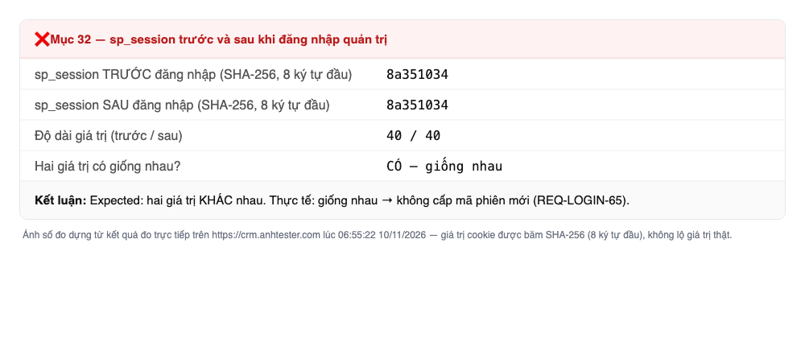
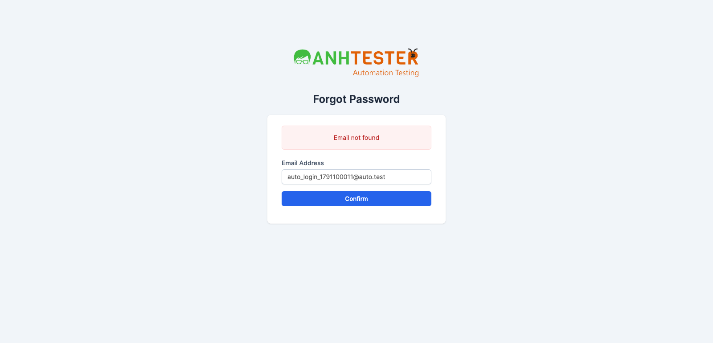
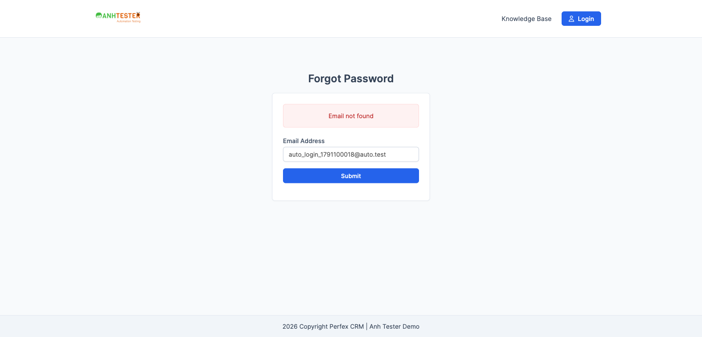
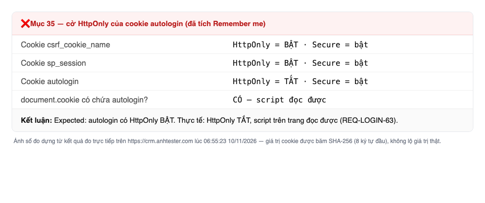
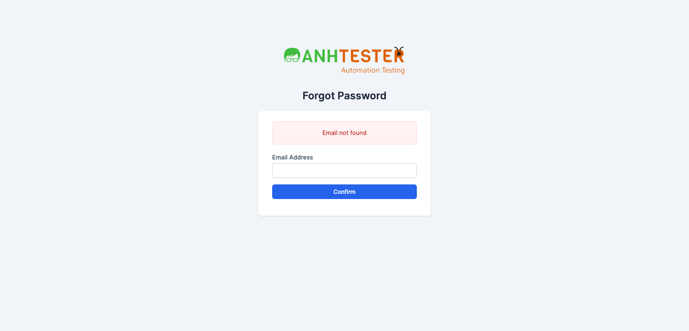
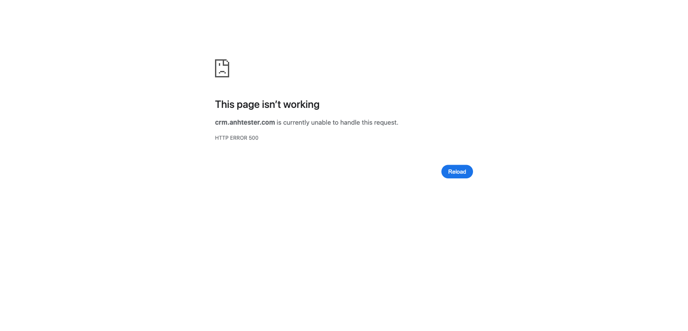
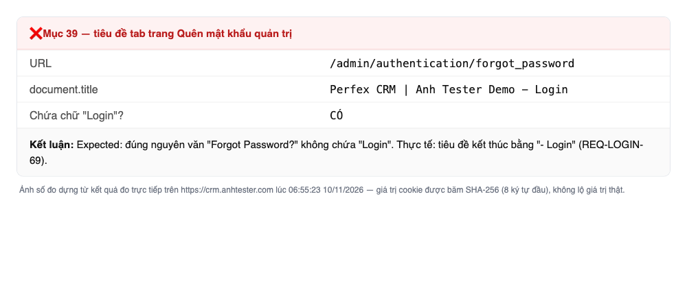
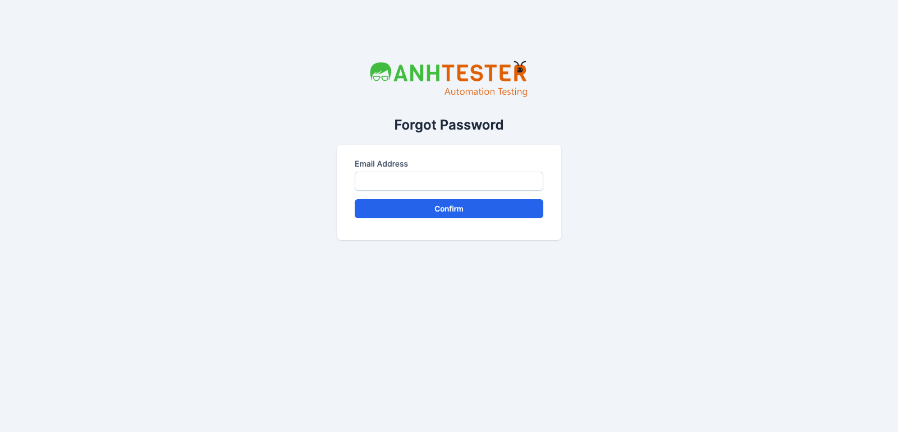
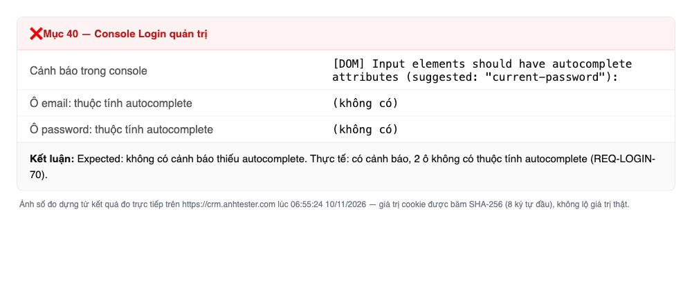
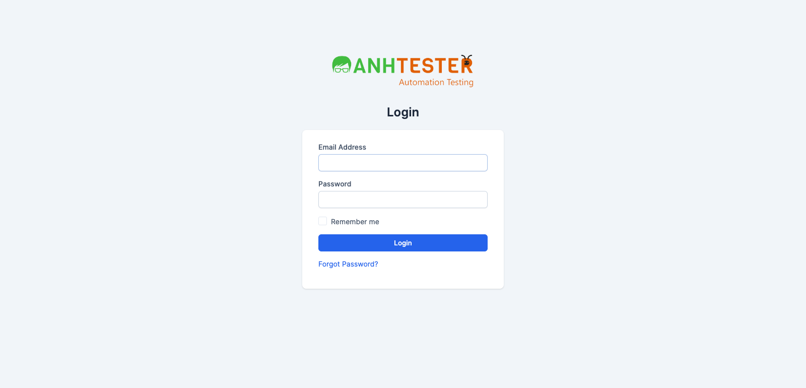

# Execution Report — Đăng nhập (`LOGIN`) · Checklist Regression

| Thông tin | Nội dung |
|---|---|
| Run ID | run_1794265314 |
| Lượt chạy | Lượt 1 của checklist `CL-regression_20261108` (lần chạy đầu tiên) |
| Nền tảng | `web` |
| Loại nguồn | `Checklist regression` · `CL-regression_20261108` |
| Nguồn checklist | [docs/checklists/login/web/checklist_regression_20261108.md](../../../../checklists/login/web/checklist_regression_20261108.md) (file `.html` cùng tên đã được gắn trạng thái) |
| Phạm vi | 40 mục (toàn bộ checklist) · không có mục `@Deprecated` |
| Môi trường | `https://crm.anhtester.com` — bản demo dùng chung (Perfex CRM · Anh Tester Demo) |
| Build / Version | Không có thông tin |
| Tài khoản | `EMAIL_ADMIN` (Staff) · `EMAIL_CUSTOMER` (contact) — lấy từ `.env`, không ghi giá trị vào báo cáo |
| Người thực hiện | Tester (agent hỗ trợ) |
| Bắt đầu → Kết thúc | 10-11-2026 06:01 → 06:10 (≈ 9 phút) |
| Môi trường dùng chung? | Có — auto-skip TC phá huỷ BẬT; không mục nào bị skip. Mục 12 gửi sai đúng 1 lần; không gửi Quên mật khẩu bằng `EMAIL_ADMIN` / `EMAIL_CUSTOMER` |

## 1. Tổng kết

| Trạng thái | Số lượng | Tỷ lệ |
|---|---|---|
| ✅ PASS | 31 | 77.5% |
| ❌ FAIL | 9 | 22.5% |
| ⚠️ BLOCKED | 0 | 0% |
| ⏭️ SKIPPED | 0 | 0% |
| **Tổng** | **40** | 100% |

> **Pass rate (không tính SKIPPED):** 31/40 = 77.5%
>
> **9 FAIL đều nằm ở nhóm "Rà lại bug đang mở" (mục 32–40)** và khớp đúng 7 bug còn mở trong [danh mục bug](../../../../bugs/README.md). Cả 31 mục còn lại (mục 1–31, gồm toàn bộ luồng sống còn `P1` của đăng nhập · phiên · đăng xuất · phân quyền) đều PASS. Không có lỗi mới.

> Kết quả checklist **không** cộng vào pass rate của bộ TC (`Loại nguồn` = Checklist).

## 2. Kết quả từng mục

| TC ID | Hạng mục kiểm tra | Kết quả | Priority | REQ ID | TC ID liên quan | Ghi chú |
|---|---|---|---|---|---|---|
| CL-regression_20261108-01 | Login quản trị — gõ `abc123` vào Password | ✅ PASS | P2 | REQ-LOGIN-02, 03, 04, 21 | CRM_LOGIN_TC_001 | Con trỏ sẵn ở ô Email, Password hiện dấu chấm |
| CL-regression_20261108-02 | `Forgot Password?` ở Login quản trị | ✅ PASS | P2 | REQ-LOGIN-15, 32 | CRM_LOGIN_TC_002, 006 | — |
| CL-regression_20261108-03 | Mở Login cổng | ✅ PASS | P2 | REQ-LOGIN-40, 49 | CRM_LOGIN_TC_003 | Không có `Register` |
| CL-regression_20261108-04 | Quên mật khẩu cổng → `Login` đầu trang | ✅ PASS | P2 | REQ-LOGIN-40, 51 | CRM_LOGIN_TC_004, 007 | — |
| CL-regression_20261108-05 | `/admin/clients` khi chưa đăng nhập → đăng nhập đúng | ✅ PASS | P1 | REQ-LOGIN-01, 18 | CRM_LOGIN_TC_005, 024 | Sau đăng nhập vào Dashboard |
| CL-regression_20261108-06 | Đăng nhập admin, không tích `Remember me` | ✅ PASS | P1 | REQ-LOGIN-17 | CRM_LOGIN_TC_008 | — |
| CL-regression_20261108-07 | Email HOA + 2 dấu cách hai đầu | ✅ PASS | P2 | REQ-LOGIN-71, 72 | CRM_LOGIN_TC_017, 018 | — |
| CL-regression_20261108-08 | Bỏ trống Email + Password | ✅ PASS | P2 | REQ-LOGIN-05, 06, 07 | CRM_LOGIN_TC_012, 013, 014 | Đúng 2 khung đỏ |
| CL-regression_20261108-09 | Email thiếu `@` ở Login quản trị | ✅ PASS | P2 | REQ-LOGIN-08 | CRM_LOGIN_TC_015 | Bong bóng trình duyệt, không nạp lại trang |
| CL-regression_20261108-10 | Email `…@autotest` ở Login quản trị | ✅ PASS | P2 | REQ-LOGIN-09, 12 | CRM_LOGIN_TC_016 | — |
| CL-regression_20261108-11 | Email không tồn tại + F5 | ✅ PASS | P1 | REQ-LOGIN-10, 11, 12, 13 | CRM_LOGIN_TC_019, 021 | — |
| CL-regression_20261108-12 | `EMAIL_ADMIN` + mật khẩu sai (đúng 1 lần) | ✅ PASS | P1 | REQ-LOGIN-10 | CRM_LOGIN_TC_020 | Cùng thông báo như mục 11 |
| CL-regression_20261108-13 | Bấm `Login` hai lần nhanh | ✅ PASS | P2 | REQ-LOGIN-17 | CRM_LOGIN_TC_035 | — |
| CL-regression_20261108-14 | Back · F5 · mở lại Login sau đăng nhập | ✅ PASS | P1 | REQ-LOGIN-17, 19 | CRM_LOGIN_TC_009, 036 | — |
| CL-regression_20261108-15 | Không `Remember me`, xoá `sp_session` 🔧 | ✅ PASS | P1 | REQ-LOGIN-22 | CRM_LOGIN_TC_025 | — |
| CL-regression_20261108-16 | Có `Remember me`, chỉ giữ `autologin` 🔧 | ✅ PASS | P1 | REQ-LOGIN-23, 24 | CRM_LOGIN_TC_026, 027 | — |
| CL-regression_20261108-17 | Menu avatar + `Logout` | ✅ PASS | P1 | REQ-LOGIN-26, 27 | CRM_LOGIN_TC_010 | Đúng 5 mục menu |
| CL-regression_20261108-18 | Back sau `Logout` | ✅ PASS | P1 | REQ-LOGIN-27, 30 | CRM_LOGIN_TC_033 | — |
| CL-regression_20261108-19 | `Logout` tab 1, bấm `Dashboard` tab 2 | ✅ PASS | P2 | REQ-LOGIN-01, 27 | CRM_LOGIN_TC_037 | — |
| CL-regression_20261108-20 | Gán lại `sp_session` cũ sau `Logout` 🔧 | ✅ PASS | P1 | REQ-LOGIN-27, 29 | CRM_LOGIN_TC_032 | Phiên cũ không dùng lại được |
| CL-regression_20261108-21 | `Logout` khi bộ đếm giờ đang chạy | ✅ PASS | P2 | REQ-LOGIN-28 | CRM_LOGIN_TC_031 | Task dựng cho mục này đã dừng bộ đếm và xoá |
| CL-regression_20261108-22 | Quên mật khẩu quản trị — email sai định dạng | ✅ PASS | P2 | REQ-LOGIN-35, 37 | CRM_LOGIN_TC_041 | — |
| CL-regression_20261108-23 | Quên mật khẩu cổng — email sai định dạng | ✅ PASS | P2 | REQ-LOGIN-54, 56 | CRM_LOGIN_TC_057 | — |
| CL-regression_20261108-24 | Đăng nhập cổng bằng `EMAIL_CUSTOMER` | ✅ PASS | P1 | REQ-LOGIN-50 | CRM_LOGIN_TC_011 | Có menu `Projects` · `Invoices` |
| CL-regression_20261108-25 | Cổng — bỏ trống Email + Password | ✅ PASS | P2 | REQ-LOGIN-42, 43 | CRM_LOGIN_TC_048, 049 | — |
| CL-regression_20261108-26 | Cổng — Email thiếu `@` | ✅ PASS | P2 | REQ-LOGIN-41, 45 | CRM_LOGIN_TC_047 | Trang nạp lại, ô Email trống |
| CL-regression_20261108-27 | Cổng — thông tin sai (thông báo nổi) | ✅ PASS | P1 | REQ-LOGIN-44, 45 | CRM_LOGIN_TC_050 | Thông báo hiện góc trên phải, tự ẩn sau ≈ 3,8 giây |
| CL-regression_20261108-28 | Cổng — đổi `Language` Vietnamese | ✅ PASS | P2 | REQ-LOGIN-46, 47, 48 | CRM_LOGIN_TC_051, 052, 053 | Login quản trị vẫn tiếng Anh |
| CL-regression_20261108-29 | `/authentication/register` | ✅ PASS | P2 | REQ-LOGIN-49 | CRM_LOGIN_TC_054 | — |
| CL-regression_20261108-30 | Staff đăng nhập Login cổng | ✅ PASS | P1 | REQ-LOGIN-60 | CRM_LOGIN_TC_061 | — |
| CL-regression_20261108-31 | Contact đăng nhập Login quản trị | ✅ PASS | P1 | REQ-LOGIN-59 | CRM_LOGIN_TC_062 | — |
| CL-regression_20261108-32 | So `sp_session` trước/sau đăng nhập 🔧 | ❌ FAIL — lỗi đã biết | P1 | REQ-LOGIN-65 | CRM_LOGIN_TC_070 | Hai giá trị **giống nhau** |
| CL-regression_20261108-33 | Quên mật khẩu quản trị — email không tồn tại | ❌ FAIL — lỗi đã biết | P2 | REQ-LOGIN-36 | CRM_LOGIN_TC_042 | Hiện `Email not found` |
| CL-regression_20261108-34 | Quên mật khẩu cổng — email không tồn tại | ❌ FAIL — lỗi đã biết | P2 | REQ-LOGIN-55 | CRM_LOGIN_TC_058 | Hiện `Email not found` |
| CL-regression_20261108-35 | Cờ `HttpOnly` của `autologin` 🔧 | ❌ FAIL — lỗi đã biết | P2 | REQ-LOGIN-63 | CRM_LOGIN_TC_071 | `HttpOnly` = tắt; `document.cookie` đọc được |
| CL-regression_20261108-36 | Quên mật khẩu quản trị — bỏ trống Email | ❌ FAIL — lỗi đã biết | P2 | REQ-LOGIN-34 | CRM_LOGIN_TC_040 | Hiện `Email not found` |
| CL-regression_20261108-37 | Quên mật khẩu cổng — bỏ trống Email | ❌ FAIL — lỗi đã biết | P2 | REQ-LOGIN-53 | CRM_LOGIN_TC_056 | Hiện `Email not found` |
| CL-regression_20261108-38 | `/admin/authentication/reset_password` không tham số | ❌ FAIL — lỗi đã biết | P3 | REQ-LOGIN-64 | CRM_LOGIN_TC_045 | HTTP 500, thân rỗng |
| CL-regression_20261108-39 | Tiêu đề tab Quên mật khẩu quản trị | ❌ FAIL — lỗi đã biết | P3 | REQ-LOGIN-69 | CRM_LOGIN_TC_046 | Tiêu đề là `Perfex CRM \| Anh Tester Demo - Login` |
| CL-regression_20261108-40 | Console Login quản trị — cảnh báo `autocomplete` 🔧 | ❌ FAIL — lỗi đã biết | P3 | REQ-LOGIN-70 | CRM_LOGIN_TC_076 | Console có cảnh báo `Input elements should have autocomplete attributes` |

## 3. Chi tiết mục FAIL

> Cả 9 mục đều là **lỗi đã biết** (bug còn mở từ lần chạy 10-10-2026). Theo ghi chú nhóm "Rà lại bug đang mở": ghi `FAIL — lỗi đã biết`, **không mở bug mới**, **không** hạ kỳ vọng (`RISK-LOGIN-07`).

### FAIL #1 — CL-regression_20261108-32 · So `sp_session` trước và sau khi đăng nhập quản trị

| | |
|---|---|
| REQ ID | REQ-LOGIN-65 |
| Priority | P1 |
| Bug đã biết | [BUG_login_1791897544_TC070](../../../../bugs/login/web/BUG_login_1791897544_TC070.md) |
| **Expected** | Hai giá trị `sp_session` khác nhau — đăng nhập cấp mã phiên mới |
| **Actual** | Hai giá trị giống nhau (cùng độ dài 40 ký tự). 🔒 Không chép giá trị cookie vào báo cáo |
| Evidence |  |
| Tái hiện được? | Có (đo lại 2 lần, cùng kết quả) |

> 📌 Ảnh mục 32, 35, 39, 40 là **ảnh số đo** dựng từ kết quả đo trực tiếp (cookie · tiêu đề tab · console không chụp được bằng ảnh màn hình trang). Giá trị cookie được băm SHA-256, chỉ hiện 8 ký tự đầu — không lộ giá trị thật.

### FAIL #2 — CL-regression_20261108-33 · Quên mật khẩu quản trị, email không tồn tại

| | |
|---|---|
| REQ ID | REQ-LOGIN-36 |
| Priority | P2 |
| Bug đã biết | [BUG_login_1791897545_TC042](../../../../bugs/login/web/BUG_login_1791897545_TC042.md) |
| **Expected** | Thông báo chứa `If this email address exists in our system, we have sent password reset instructions.`; không có `Email not found` |
| **Actual** | Khung đỏ `Email not found` |
| Evidence |  |
| Tái hiện được? | Có |

### FAIL #3 — CL-regression_20261108-34 · Quên mật khẩu cổng, email không tồn tại

| | |
|---|---|
| REQ ID | REQ-LOGIN-55 |
| Priority | P2 |
| Bug đã biết | [BUG_login_1791897545_TC042](../../../../bugs/login/web/BUG_login_1791897545_TC042.md) (chung bug với mục 33) |
| **Expected** | Như mục 33 |
| **Actual** | Khung đỏ `Email not found` |
| Evidence |  |
| Tái hiện được? | Có |

### FAIL #4 — CL-regression_20261108-35 · Cờ `HttpOnly` của cookie `autologin`

| | |
|---|---|
| REQ ID | REQ-LOGIN-63 |
| Priority | P2 |
| Bug đã biết | [BUG_login_1791897547_TC071](../../../../bugs/login/web/BUG_login_1791897547_TC071.md) |
| **Expected** | Cookie `autologin` có `HttpOnly` bật — script trên trang không đọc được |
| **Actual** | `HttpOnly` = tắt; `document.cookie` trên trang có chứa `autologin` (hình thái: chuỗi dài, không chép giá trị). Hai cookie còn lại `sp_session` và `csrf_cookie_name` có `HttpOnly` bật |
| Evidence |  |
| Tái hiện được? | Có (đo 3 lần: mục 16, mục 35 và đo lại để dựng ảnh) |

### FAIL #5 — CL-regression_20261108-36 · Quên mật khẩu quản trị, bỏ trống Email

| | |
|---|---|
| REQ ID | REQ-LOGIN-34 |
| Priority | P2 |
| Bug đã biết | [BUG_login_1791897546_TC040](../../../../bugs/login/web/BUG_login_1791897546_TC040.md) |
| **Expected** | Khung đỏ `The Email Address field is required.`; không có `Email not found` |
| **Actual** | Khung đỏ `Email not found` |
| Evidence |  |
| Tái hiện được? | Có |

### FAIL #6 — CL-regression_20261108-37 · Quên mật khẩu cổng, bỏ trống Email

| | |
|---|---|
| REQ ID | REQ-LOGIN-53 |
| Priority | P2 |
| Bug đã biết | [BUG_login_1791897546_TC040](../../../../bugs/login/web/BUG_login_1791897546_TC040.md) (chung bug với mục 36) |
| **Expected** | Khung đỏ `The Email Address field is required.`; không có `Email not found` |
| **Actual** | Khung đỏ `Email not found` |
| Evidence |  |
| Tái hiện được? | Có |

### FAIL #7 — CL-regression_20261108-38 · `/admin/authentication/reset_password` không tham số

| | |
|---|---|
| REQ ID | REQ-LOGIN-64 |
| Priority | P3 |
| Bug đã biết | [BUG_login_1791897548_TC045](../../../../bugs/login/web/BUG_login_1791897548_TC045.md) |
| **Expected** | Trang báo không tìm thấy (Not Found), không phải lỗi máy chủ |
| **Actual** | HTTP **500**, thân phản hồi rỗng; trình duyệt hiện trang lỗi mặc định |
| Evidence |  |
| Tái hiện được? | Có |

### FAIL #8 — CL-regression_20261108-39 · Tiêu đề tab Quên mật khẩu quản trị

| | |
|---|---|
| REQ ID | REQ-LOGIN-69 |
| Priority | P3 |
| Bug đã biết | [BUG_login_1791897549_TC046](../../../../bugs/login/web/BUG_login_1791897549_TC046.md) |
| **Expected** | Đúng nguyên văn `Forgot Password?`, không chứa chữ `Login` |
| **Actual** | `Perfex CRM \| Anh Tester Demo - Login` (đọc từ `document.title`; ảnh chụp viewport không hiện thanh tab) |
| Evidence |   |
| Tái hiện được? | Có |

### FAIL #9 — CL-regression_20261108-40 · Console Login quản trị

| | |
|---|---|
| REQ ID | REQ-LOGIN-70 |
| Priority | P3 |
| Bug đã biết | [BUG_login_1791897550_TC076](../../../../bugs/login/web/BUG_login_1791897550_TC076.md) |
| **Expected** | Không có cảnh báo của Chrome về ô nhập thiếu thuộc tính `autocomplete` |
| **Actual** | Console có `[DOM] Input elements should have autocomplete attributes (suggested: "current-password")`; ô `email` và `password` đều không có thuộc tính `autocomplete` |
| 🔧 Ghi chú kỹ thuật | Đọc qua console của Playwright (mức `verbose`), không phải tab Console của DevTools — cùng nguồn cảnh báo |
| Evidence |   |
| Tái hiện được? | Có |

## 4. Mục BLOCKED

Không có.

## 5. Dữ liệu đã tạo & dọn dẹp

| Dữ liệu | ID | Nơi tạo | Đã xoá? |
|---|---|---|---|
| Task `auto_login_timer_1791100008` (dựng cho mục 21) | 2184 | `/admin/tasks` | ✅ Đã dừng bộ đếm rồi xoá |

> Đối chiếu số liệu: tổng số task trước khi tạo 312 → sau khi xoá 312 ✅ môi trường trả về nguyên trạng.
>
> Các lần gửi form Login / Quên mật khẩu bằng email `auto_login_<số>…` (không tồn tại) không tạo bản ghi nào. Cookie của phiên trình duyệt kiểm thử đã xoá cuối buổi chạy. Ngôn ngữ cổng đã đổi sang Vietnamese ở mục 28 chỉ nằm trong phiên trình duyệt này, không lưu vào tài khoản.

## 6. Đề xuất bước tiếp theo

- 9 mục FAIL ứng với 7 bug còn mở → **không** cần `/create-bug-report`. Khi dev báo đã sửa thì chạy `/retest-fixed-bugs` để đóng bug.
- Có thể ghi vào mỗi bug một dòng "còn tái hiện ở lượt 1 checklist regression 10-11-2026" nếu team muốn lưu lịch sử (chưa thực hiện).
- Chưa cần `/review-testcases`: không có TC `@NeedsVerify` lệch Expected.
